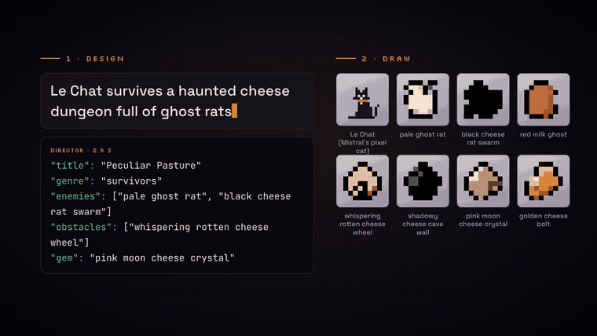
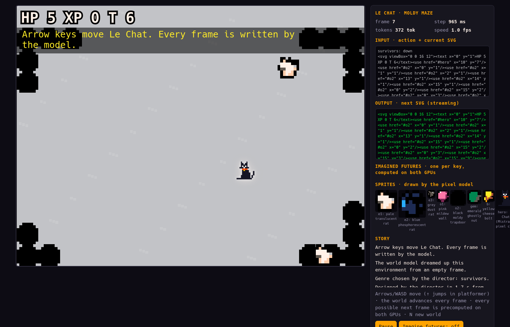
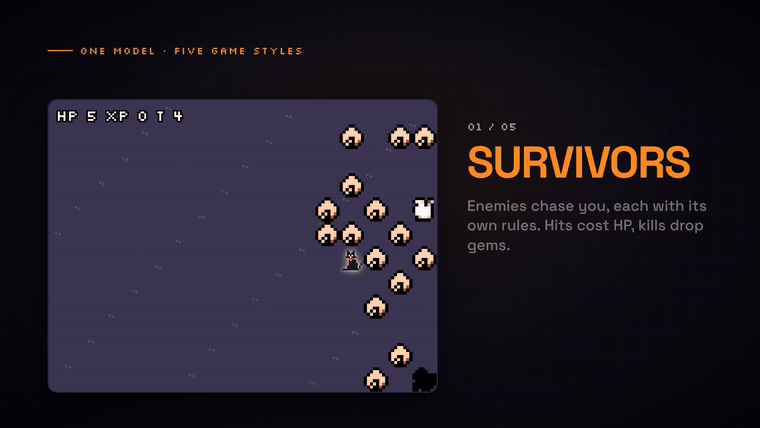

# Le Chat Atelier

**Type a prompt. A fine-tuned Ministral 3B dreams up a tiny 8-bit world and then *is* the game engine:** every frame you see is a complete SVG that the model writes from the previous frame and the key you pressed.



▶ **[Watch the 57-second launch film](media/le-chat-atelier-launch.mp4)** (1080p, made in Remotion, every game screen redrawn from real model output)



## What it does

You type something like *"Le Chat survives a haunted cheese dungeon full of ghost rats"*. Within a couple of seconds:

1. A **director** model reads the prompt and designs the world as JSON: a title, a game style, enemies, obstacles, a collectible, a projectile and an opening story beat.
2. A **sprite model** draws every character and item as 8×8 pixel art, all at once, streamed row by row into the page.
3. A **world model** writes the first frame of the level from an empty SVG, then writes every next frame as you play.
4. Every 12 frames a **narrator** continues the story, and every 30 frames the director invents a new enemy that the sprite model draws on the spot.

The hero is Le Chat, Mistral's pixel cat.

## How it works

```
prompt ──► DIRECTOR (Ministral 3B, JSON-schema output) → title, genre, cast, items, story
             │
             ├─► SPRITE MODEL (fine-tuned)   each name → 8×8 PICO-8 sprite → <defs> symbol (#e1, #gem, ...)
             │
             └─► WORLD MODEL (fine-tuned)    "<genre>: <key>\n<current SVG frame>"  →  next SVG frame
                       ▲                                              │
                       └────────────── rendered, then fed back in ────┘
```

A frame is a 16×12 grid written as tiny SVG. The model only places sprites by reference; the sprite model's art is drawn once per world and reused:

```svg
<svg viewBox="0 0 16 12"><text x="0" y="1">HP 5 XP 0 T 6</text><use href="#hero" x="10" y="7"/><use href="#e1" x="13" y="2"/>…</svg>
```

**One world model covers five game styles.** The director maps any prompt to the closest one and themes everything else.

| Style | What the model simulates |
|---|---|
| survivors | top-down; three enemy kinds chase you by different rules; obstacles block; auto-attack turns enemies into gems; damage; spawns |
| snake | the head moves, the body follows, eating grows it, reversing is ignored, a crash resets the game |
| shooter | your ship auto-fires, bullets rise, enemies descend, hits score, landings cost HP |
| dodge | vertical scroller: obstacles and coins fall, collisions cost HP, coins score |
| platformer | side view with gravity and jumps (vertical speed is in the HUD), platforms, walking enemies, coins |



### Is the game really the model?

Yes. There is no game engine computing state between frames. The browser sends the model's own previous frame plus your key, and the model writes positions, collisions, damage, pickups, spawns and the HUD text. What surrounds it:

- **A grammar** (llama.cpp GBNF) limits sampling to well-formed frames for the style: allowed sprite kinds, HUD format, coordinates on the grid. It never chooses values.
- **First frame:** the model generates it from an empty SVG. If it fails the style's sanity checks three times, the rule simulator supplies one instead.
- **Edge crossing:** walking off the edge makes the model generate the next area; code carries over HP/XP/tick and puts Le Chat at the opposite edge.
- **Smoothing** is browser animation between two consecutive model frames. It's visual only and can be turned off (`?raw=1`).
- **Imagine futures** asks the model for the next frame for *every* key at once, so the frame for whichever key you press is usually already written.

## Results

World model, round 2, on held-out transitions (greedy decoding):

| Style | Exact next frame | HUD correct | Hero correct | ms per frame (H100) |
|---|---|---|---|---|
| snake | 93% | 100% | 100% | 217 |
| shooter | 73% | 100% | 100% | 417 |
| platformer | 70% | 100% | 100% | 393 |
| dodge | 43% | 97% | 100% | 585 |
| survivors | 40% | 97% | 97% | 370 |

Most exact-frame misses are random enemy spawns, which no model can predict, rather than broken rules. Over 60 self-fed frames per style, the tick counter advanced correctly and the hero stayed on screen 100% of the time. Validation loss: 0.0073. `pipeline/world_model/input_proof.py` shows the same frame with different keys: the hero moves the right way, the platformer jumps, and snake ignores reversing.

## The models

All three are [Ministral 3 3B Instruct](https://huggingface.co/mistralai/Ministral-3-3B-Instruct-2512-BF16). Two are full fine-tunes (every weight updated, fp32 master weights with bf16 compute), not adapters.

| Model | Trained on | Weights |
|---|---|---|
| World model | ~90k frame transitions generated by rule simulators for the five styles (`pipeline/world_model/wm_multi2.py`), in three stages: survivors only, five styles, then five styles plus 10k extra start frames | [`B-Divyesh/atelier-svg-world-model`](https://huggingface.co/B-Divyesh/atelier-svg-world-model) |
| Sprite model | ~135k captioned sprites from [pixel-art-atlas-1.4m](https://huggingface.co/datasets/Angais/pixel-art-atlas-1.4m) (CC0), shrunk to 8×8 and mapped to the PICO-8 palette by CIELAB distance; about 60 tokens per sprite | [`B-Divyesh/atelier-pixel-sprites-8x8`](https://huggingface.co/B-Divyesh/atelier-pixel-sprites-8x8) |
| Director and narrator | the base model, constrained by JSON schemas | (base model) |

## Serving and speed

Everything runs as 8-bit (Q8_0) [llama.cpp](https://github.com/ggml-org/llama.cpp) servers. The next frame mostly repeats the current one, so **n-gram speculative decoding** speeds the world model up a lot with identical output.

| Server | GPU memory |
|---|---|
| Director and narrator (base model, 8 slots) | 7.5 GB |
| Sprite model (16 slots) | 5.8 GB |
| World model, one copy per GPU (6 slots each, n-gram speculation) | 6.7 GB each |
| **Total on 2× H100** | **~27 GB of 160 GB** |

Measured with players stepping through the real game server (`pipeline/serving/load_test.py`):

| Load | GPU utilisation (avg / peak) | Frames per second |
|---|---|---|
| 1 player | ~30% / 75% per GPU | 2.3 |
| 4 players | ~50% / 82% per GPU | 1.7 each, 6.8 total |

One player can't fill the hardware because each frame waits on the previous one; a second GPU adds players, not speed. The whole stack would fit on a single H100.

## Run it

You need llama.cpp built with CUDA, Python 3 with `tokenizers` and `huggingface_hub`, and three GGUF files: the two from Hugging Face above, plus the base model converted with llama.cpp's `convert_hf_to_gguf.py --outtype q8_0`.

```sh
# 1. director + narrator (base model)
llama-server --model base-q8_0.gguf --port 8099 --n-gpu-layers 99 --flash-attn on --ctx-size 32768 --parallel 8
# 2. sprite model
llama-server --model pixlab-q8_0.gguf --port 8103 --n-gpu-layers 99 --flash-attn on --ctx-size 16384 --parallel 16
# 3. world model (one copy per GPU; on a single GPU run one and drop the wm_b upstream below)
CUDA_VISIBLE_DEVICES=0 llama-server --model wmm2-q8_0.gguf --port 8110 --n-gpu-layers 99 --flash-attn on --ctx-size 24576 --parallel 6 --spec-type ngram-simple --spec-draft-n-max 32
CUDA_VISIBLE_DEVICES=1 llama-server --model wmm2-q8_0.gguf --port 8111 --n-gpu-layers 99 --flash-attn on --ctx-size 24576 --parallel 6 --spec-type ngram-simple --spec-draft-n-max 32
# 4. game server
cd app
python fast_server.py --port 8090 --page app.html \
  --upstream base=http://127.0.0.1:8099#base --upstream pix8=http://127.0.0.1:8103#pix8 \
  --upstream wm=http://127.0.0.1:8110#wm --upstream wm_b=http://127.0.0.1:8111#wm --default base --temperature 0.3
```

Open `http://127.0.0.1:8090/game?prompt=Le%20Chat%20survives%20a%20haunted%20cheese%20dungeon%20full%20of%20ghost%20rats`. Arrow keys or WASD move Le Chat (↑ jumps in the platformer), N starts a new world. The side panel shows the exact SVG going into the model and coming out on each step.

**Prompt formats**, if you want to call the models directly:

- World model: `<s>[INST]{genre}: {action}\n{current_svg}[/INST]` with action ∈ `up`, `down`, `left`, `right`, `stay`, `start`.
- Sprite model: `<s>[SYSTEM_PROMPT]Draw the requested game sprite as 8x8 pixel art in the PICO-8 palette. Reply with 8 lines of 8 characters: . is transparent, 0-f are palette colors.[/SYSTEM_PROMPT][INST]{name}[/INST]`

## Train it

The training scripts were written for a rented 2× H100 machine during a hackathon. They work, but several have that machine's paths (`/dev/shm/work`, `/workspace/atelier`) baked in, so treat them as a reference rather than a one-command pipeline.

```sh
# world-model data: N transitions per style from the rule simulators, then extra start frames
python pipeline/world_model/wm_multi2.py 9000 all.jsonl 0
python pipeline/world_model/add_starts.py all.jsonl 2000
# split into data/train.jsonl and data/valid.jsonl, then full fine-tune
python pipeline/world_model/train_wm.py --data data --init-model <Ministral-3-3B-Instruct-2512-BF16 or previous round> \
  --out wm-model --mb-tokens 6144 --minutes 120
# sprite data and training
python pipeline/sprites/pix_prep_lab2.py "<pixel-art-atlas parquet glob>" 8
python pipeline/sprites/train_pix2.py --data data-pix --init-model <base or previous round> --out pix-model
# export to Q8_0 GGUF, then evaluate one-step accuracy and closed-loop stability
bash pipeline/serving/export.sh wm-model/step-XXXX wmm2 full
python pipeline/world_model/wm_eval_multi.py 8110 heldout.jsonl
```

`pipeline/serving/playtest.py` plays the game in a real Firefox through Playwright, and `pipeline/serving/load_test.py` measures throughput and GPU utilisation.

## The launch film

`video/` is a [Remotion](https://www.remotion.dev) project. Every scene is drawn from `video/src/data.json`, real frames, sprites and story text recorded from five live sessions by `video/capture.py`. Nothing is screen-recorded.

```sh
cd video && npm install
npx remotion studio                                       # edit and preview
npx remotion render Launch out/le-chat-atelier-launch.mp4  # 1920×1080, 30 fps, 57 s
```

Remotion is free for individuals and companies of up to 3 people; larger companies need a [company licence](https://www.remotion.dev/license).

## Repository layout

```
app/                    the game, exactly as it ran in the demo
  fast_server.py          all endpoints: /start, /step_stream, /step_all, /arena, /sprite_stream, /narrate, ...
  world.html              the game client (/game)
  wm_multi.py, wm_sim*.py rule simulators, used only for the first-frame fallback
pipeline/
  world_model/            simulators, data generation, training, evaluation, input proof
  sprites/                pixel-art data preparation, training, evaluation
  serving/                GGUF export, speed and speculative-decoding benchmarks, load test, play test
  illustration/           the earlier SVG illustration experiments
  cards/                  the Hugging Face model cards
video/                  the Remotion launch film
illustration_studio/    the project this grew out of (see below)
media/                  film, previews, screenshots
```

## Where it started

The project began as a text-to-SVG illustration studio: a LoRA fine-tune of Ministral 3B on [OmniSVG/MMSVG-Illustration](https://huggingface.co/datasets/OmniSVG/MMSVG-Illustration) with a local web studio, built by [78i87](https://github.com/78i87) in [78i87/le-chat-atelier](https://github.com/78i87/le-chat-atelier). That code is in `illustration_studio/`. During the hackathon it turned into the 8-bit world model above. The illustration adapters were trained on CC BY-NC-SA 4.0 data and are not part of this repo or the released models; the world and sprite models were trained from the base model.

## Credits

- **Base model:** Ministral 3 3B Instruct by Mistral AI (Apache 2.0).
- **Le Chat's sprite** is Mistral AI's pixel cat, copied pixel for pixel from [mistral.ai](https://mistral.ai) and used unmodified under their [brand guidelines](https://mistral.ai/brand). It belongs to Mistral AI.
- **Sprite training data:** [Angais/pixel-art-atlas-1.4m](https://huggingface.co/datasets/Angais/pixel-art-atlas-1.4m) (CC0). Palette: PICO-8.
- **Fonts in the film:** Space Grotesk, JetBrains Mono and Silkscreen (SIL Open Font License).
- **Serving:** llama.cpp.
